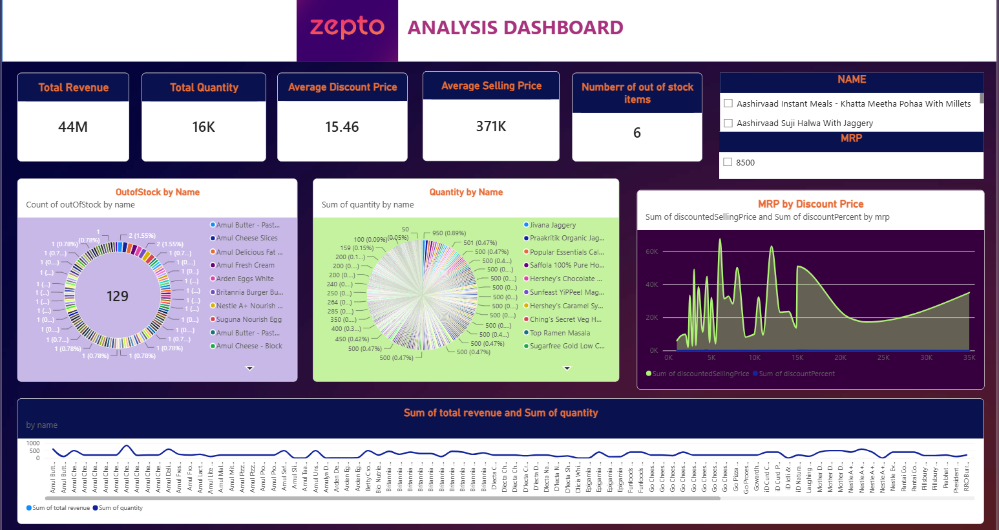

# Zepto Analysis Dashboard

An interactive Power BI dashboard designed to analyze retail sales performance, inventory availability, pricing strategy, and key business metrics for Zepto product offerings.

---

## Dashboard Preview



---

## Key Business Metrics & Insights

Based on the dataset visualization:

- **Total Revenue:** 44M
- **Total Quantity Sold:** 16K items
- **Average Selling Price:** 371K
- **Average Discount Price:** 15.46
- **Out of Stock Items:** 6 items currently out of stock

---

## Visualizations & Key Features

- **KPI Cards:** High-level summary of business figures including total sales, overall quantities, selling prices, and stockout counts.
- **Out of Stock Analysis:** Breakdown of out-of-stock items categorized by product names (e.g., Amul Butter, Amul Cheese Slices, Amul Fresh Cream).
- **Quantity Distribution:** Product-level view of units sold to identify top-performing inventory items (e.g., Jivana Jaggery, Praakritik Organic Jaggery).
- **MRP vs. Discount Price Trends:** Line analysis evaluating original pricing strategy against actual discounted selling prices across various MRP tiers.
- **Revenue & Quantity Correlation:** Detailed line chart mapping revenue generation directly against sold item quantities across all product brands.

---

## Repository Structure

```text
├── Zepto analysis dashboard.pbix     # Power BI Desktop report file
├── Zepto.xlsx                        # Dataset source file
├── Screenshot.png                    # High-res screenshot of the Power BI dashboard
├── Zepto-Featured-Image-Option-2.png # Brand header asset
├── dark-gradient.jpg                 # Background styling asset
└── README.md                         # Project documentation


